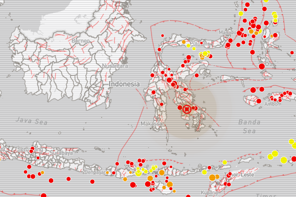
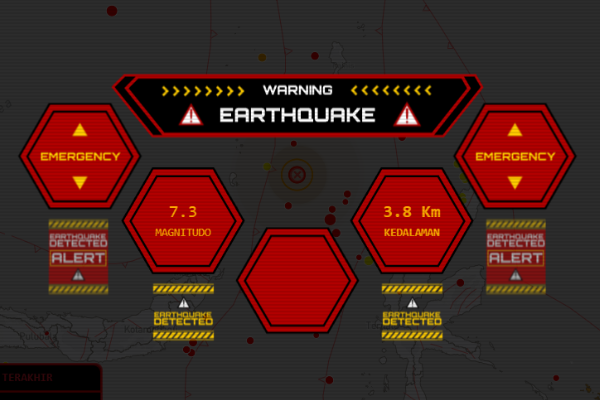
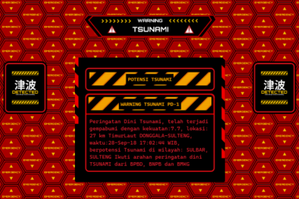
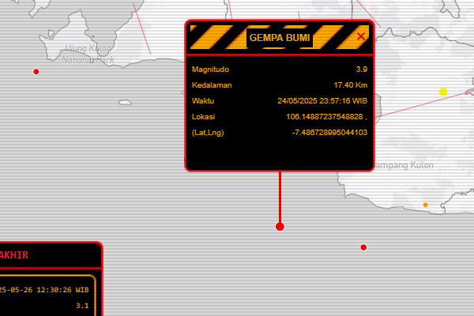
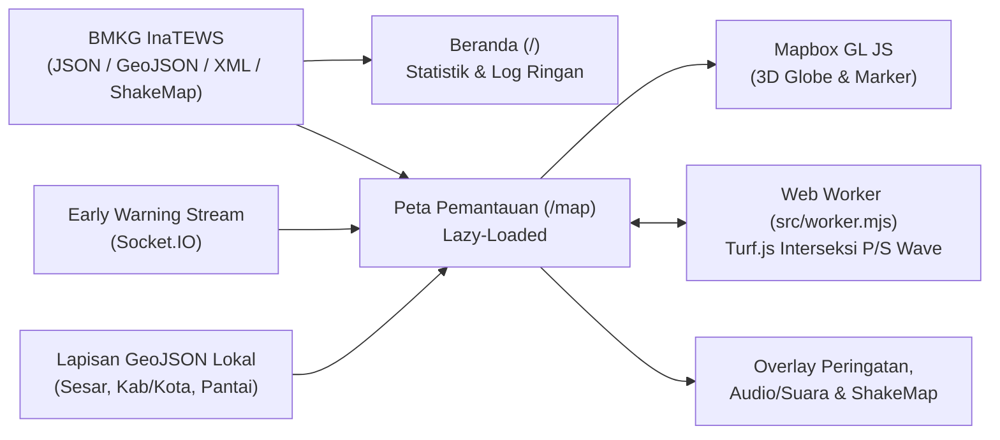

# SeismoTrack

**Platform pemantauan gempa bumi dan peringatan dini tsunami Indonesia secara real-time berbasis data resmi BMKG InaTEWS.**


SeismoTrack menyajikan informasi seismik resmi dari Badan Meteorologi, Klimatologi, dan Geofisika (**BMKG — InaTEWS**) ke dalam dua antarmuka terpisah: **halaman beranda ringan** untuk ringkasan statistik gempa terkini, dan **halaman peta pemantauan 3D interaktif** untuk visualisasi episentrum, garis sesar aktif, propagasi gelombang P & S, ShakeMap MMI, serta peringatan dini gempa dan tsunami.

---

## Pratinjau Antarmuka

| Peta Episentrum & Garis Sesar | Peringatan Gempa Bumi |
| :---: | :---: |
|  |  |

| Peringatan Dini Tsunami | Detail Kejadian & Koordinat |
| :---: | :---: |
|  |  |

---

## Fitur Utama

### 1. Beranda Ringan & Statistik BMKG (`/`)
- **Arsitektur Lazy-Loaded**: Modul berat seperti Mapbox GL JS, Turf.js, Web Worker, dan Socket.IO dipisahkan melalui `React.lazy` ke rute `/map` agar beranda dimuat cepat.
- **Ringkasan Kejadian Real-Time**: Menampilkan total kejadian dari feed aktif BMKG, magnitudo tertinggi, jumlah gempa dangkal (`≤ 50 km`), dan wilayah paling aktif.
- **Filter Distribusi Magnitudo**: Pengelompokan interaktif (`< M 2.5`, `M 2.5–3.4`, `M 3.5–4.4`, `≥ M 4.5`) yang langsung menyaring daftar kejadian terbaru.
- **Log Kejadian Terkini**: Menampilkan magnitudo, lokasi, kategori kedalaman, koordinat lintang/bujur, dan waktu dalam zona **WIB (UTC+7)**.

### 2. Peta Pemantauan Interaktif 3D Globe (`/map`)
- **Visualisasi Globe Satelit**: Menggunakan Mapbox GL JS (`standard-satellite`, proyeksi `globe`) dengan atmosfer dan kontrol navigasi penuh.
- **Lapisan Geospasial Indonesia**:
  - Batas administratif kabupaten/kota (`all_kabkota_ind_reduce.geojson`).
  - Garis sesar tektonik aktif Indonesia (`indo_faults_lines.geojson`).
  - Garis pantai untuk sorotan wilayah terdampak tsunami (`garis_pantai.geojson`).
- **Klasifikasi Kedalaman Episentrum**: Ukuran titik mengikuti magnitudo, sementara warna titik merepresentasikan 5 kelas kedalaman:
  - `≤ 50 km` (Dangkal — Merah)
  - `51–100 km` (Menengah Awal — Oranye)
  - `101–250 km` (Menengah — Kuning)
  - `251–600 km` (Dalam — Hijau)
  - `> 600 km` (Sangat Dalam — Biru)

### 3. Propagasi Gelombang P & S + Deteksi Wilayah Terdampak
- **Simulasi Perambatan Seismik**: Memodelkan perambatan gelombang primer (**P-wave: 6 km/s**) dan gelombang sekunder (**S-wave: 3 km/s**) dari episentrum.
- **Kalkulasi Off-Main-Thread**: Perhitungan interseksi poligon kabupaten/kota dan garis pantai menggunakan **Turf.js** dijalankan di dalam **Web Worker** (`src/worker.mjs`) agar animasi peta tetap halus.
- **Estimasi Dampak Wilayah**: Menampilkan daftar kabupaten/kota yang berpotensi terdampak beserta jarak dan estimasi waktu tiba guncangan.

### 4. Peringatan Dini Gempa, Tsunami, Audio & ShakeMap
- **Peringatan Real-Time**: Memadukan feed resmi BMKG InaTEWS dengan koneksi WebSocket (`socket.io-client`) untuk menerima pembaruan gempa dan peringatan tsunami tanpa memuat ulang halaman.
- **Status Peringatan Tsunami**: Menyorot garis pantai terdampak secara berkedip sesuai level peringatan BMKG (**WASPADA**, **SIAGA**, **AWAS**).
- **Notifikasi Suara & Kontrol Mute**: Dilengkapi efek sirine dan narasi suara berbahasa Indonesia (`public/sounds` & `public/voice`) dengan tombol bisu (mute) di bilah kontrol atas.
- **Pratinjau ShakeMap MMI**: Menampilkan peta intensitas guncangan (ShakeMap) langsung dari penyimpanan resmi BMKG InaTEWS (`bmkg-content-inatews.storage.googleapis.com`).
- **Mode Simulasi Edukasi**: Menyediakan tombol **Simulasi Gempa** dan **Simulasi Tsunami** di halaman peta untuk menguji alur peringatan dan edukasi kesiapsiagaan.

---

## Arsitektur Sistem



---

## Tech Stack

| Kategori | Teknologi |
| --- | --- |
| **Framework & Bahasa** | React 18, TypeScript 5.7, React Router v7 |
| **Build Tool** | Vite 6 |
| **Pemetaan & Geospasial** | Mapbox GL JS 3, `mapbox-gl-animated-popup`, Turf.js 7, Polylabel |
| **Real-Time & Parsing Data** | Socket.IO Client, Web Worker (`web-worker`), `fast-xml-parser`, Luxon |
| **Styling & Komponen UI** | Tailwind CSS 3, Radix UI, Lucide React, Motion |
| **Deployment** | Vercel (`vercel.json` SPA rewrite) |

---

## Struktur Direktori

```text
SeismoTrack/
├── public/
│   ├── geojson/                     # Data batas kab/kota, garis pantai, dan sesar Indonesia
│   ├── images/                      # Aset ikon peringatan dan tangkapan layar beranda
│   ├── sounds/                      # Efek audio notifikasi dan sirine peringatan
│   └── voice/                       # Narasi suara peringatan berbahasa Indonesia
├── src/
│   ├── components/
│   │   ├── alerts/                  # Kartu & daftar peringatan gempa/tsunami aktif
│   │   ├── cards/                   # Panel Event Log, ShakeMap, popup detail, ringkasan BMKG
│   │   ├── lib/                     # Fetcher feed BMKG, updater, dan modul simulasi demo
│   │   ├── libs/                    # Definisi interface TypeScript (InfoGempa, InfoTsunami, dll.)
│   │   ├── map/                     # MapContainer (Mapbox GL) & formatter kedalaman/magnitudo
│   │   ├── marker/                  # Kelas animasi episentrum & gelombang P/S (TitikGempa, TitikTsunami)
│   │   └── ui/                      # Tombol kontrol, simulasi, dan komponen dasar UI
│   ├── pages/
│   │   ├── landing-page/            # Beranda (/), hook useBmkgEarthquakes, dan seksi konten
│   │   └── map-page/                # Ruang kerja pemantauan peta real-time (/map)
│   ├── routes/                      # Konfigurasi routing & lazy-loading (/ dan /map)
│   ├── styles/                      # Gaya global Tailwind dan workspace peta
│   ├── worker.mjs                   # Web Worker kalkulasi interseksi gelombang P/S dengan Turf.js
│   ├── App.tsx
│   └── main.tsx
├── index.html
├── package.json
├── tailwind.config.js
├── vercel.json                      # Aturan SPA rewrite untuk deployment Vercel
└── vite.config.ts
```

---

## Memulai di Lokal

### Prasyarat
- **Node.js** versi `18` atau lebih baru
- **npm** (atau package manager yang kompatibel)
- **Mapbox Access Token** aktif dari [Mapbox Account](https://account.mapbox.com/)

### 1. Clone Repositori & Instal Dependensi

```bash
git clone https://github.com/hiraeth12/SeismoTrack.git
cd SeismoTrack
npm install
```

### 2. Konfigurasi Variabel Lingkungan (`.env`)

Buat file `.env` di direktori root proyek dan isi variabel berikut:

```env
VITE_MAPBOX_TOKEN=pk.your_mapbox_public_token_here
VITE_BMKG_GEMPA_ALL=https://bmkg-content-inatews.storage.googleapis.com/gempaQL.json
VITE_BMKG_GEMPA_DIRASAKAN=https://bmkg-content-inatews.storage.googleapis.com/datagempa.json
VITE_BMKG_GEMPA_TERDETEKSI=https://bmkg-content-inatews.storage.googleapis.com/lastQL.json
VITE_BMKG_TSUNAMI=https://bmkg-content-inatews.storage.googleapis.com/last30event.xml
```

> **Catatan:** Pastikan setiap endpoint mengarah ke layanan feed BMKG InaTEWS yang valid. Jangan pernah membagikan atau meng-commit token pribadi Mapbox Anda ke repositori publik.

### 3. Jalankan Server Pengembangan

```bash
npm run dev
```

Aplikasi dapat diakses melalui `http://localhost:5173` (atau port lain yang ditampilkan Vite di terminal).

---

## Skrip NPM

| Perintah | Deskripsi |
| --- | --- |
| `npm run dev` | Menjalankan server pengembangan Vite dengan Hot Module Replacement (HMR). |
| `npm run build` | Melakukan pengecekan tipe TypeScript (`tsc -b`) dan membangun bundle produksi (`vite build`). |
| `npm run preview` | Menjalankan pratinjau lokal dari hasil build produksi. |
| `npm run lint` | Menjalankan ESLint untuk memeriksa kualitas kode di seluruh proyek. |

---

## Deployment

Proyek ini sudah dikonfigurasi untuk deployment langsung ke **Vercel** melalui [`vercel.json`](./vercel.json) yang mengarahkan seluruh rute SPA ke `index.html`.

Saat melakukan deployment:
1. Hubungkan repositori ke proyek Vercel.
2. Tambahkan seluruh variabel `VITE_*` dari bagian konfigurasi `.env` ke menu **Environment Variables** di pengaturan proyek Vercel.
3. Deploy menggunakan preset **Vite** (`npm run build`, output directory `dist`).

---

## Sumber Data & Penafian

- Seluruh data gempa bumi, peta guncangan (ShakeMap MMI), dan informasi peringatan dini tsunami bersumber dari **BMKG (Badan Meteorologi, Klimatologi, dan Geofisika) — InaTEWS**.
- **Penafian:** SeismoTrack dikembangkan sebagai platform pemantauan visual dan edukasi kesiapsiagaan (Proyek Akhir TPBW). Dalam kondisi darurat gempa bumi atau tsunami, selalu rujuk dan ikuti instruksi resmi dari **BMKG**, **BNPB**, serta **BPBD** setempat.
